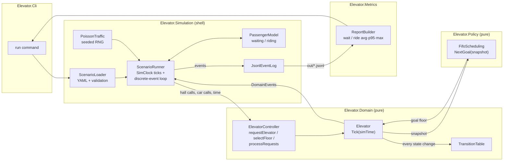
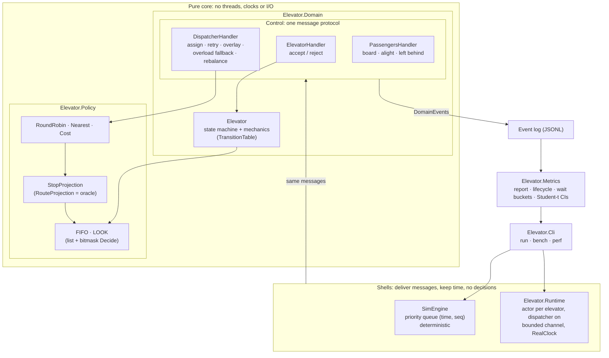
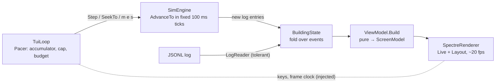

# Architecture evolution

How the design grows stage by stage. Each version links to the ADRs that justify it.

## v1: Easy (tag `v1-easy`)

One elevator, floors 1–10, FIFO hall-call scheduling with real mechanics, a headless deterministic simulation.
See ADR-001 (FIFO), ADR-002 (state machine) and ADR-003 (sim clock and pure core).

Key properties:
- Arrows into Domain and Policy carry data only. Those projects never call out, read a clock or do I/O.
- The event log is the only input to Metrics. The `run` command builds its report by reading back the file it wrote.
- The same scenario and seed give a byte-identical log at any tick size.

Baseline measured at v1 (`scenarios/v1-poisson.yaml`, seed 42, FIFO): wait avg 77.0 s, p95 193.0 s,
max 242.0 s; 69/69 served.

## v2: Medium (tag `v2-medium`)

Four elevators on 20 floors with destination dispatch, LOOK, cost-based dispatch, capacity, and a real threaded
runtime next to the deterministic simulator. The ADRs:

| ADR | Decision |
|---|---|
| 004 | LOOK per elevator (supersedes 001) |
| 005 | actors and one shared protocol, not locks |
| 006 | the cost function, its fast projection, staleness, overlay and overload |
| 007 | the event log as backbone |
| 008 | metric definitions and two kinds of time |
| 009 | destination dispatch and capacity |
| 010 | next-trip under full load |

Key properties:
- **All decisions are in pure handlers and policies.** The deterministic engine and the actor runtime deliver the same
  messages to them; a cross-check test runs the same scenario through both.
- **The dispatcher never shares memory with elevators.** It sees snapshots (possibly stale) plus its own pending
  proposals (overlay); elevators have the final say (accept / reject).
- **Every measured claim comes from the event log, with paired CIs on common random numbers.**

**Results at v2** (wait avg / p95 in sim seconds, held-out seeds 21–40, next-trip):

| Profile | FIFO + Nearest (baseline) | LOOK + Nearest | LOOK + Cost (default) |
|---|---|---|---|
| up-peak | 26.9 / 103.9 | 20.7 / 59.4 | **15.8 / 37.9** |
| down-peak | 251.1 / 584.6 (saturated) | 29.3 / 87.7 | **20.6 / 53.2** |
| lunch | 95.4 / 325.7 | 21.0 / 78.1 | **13.8 / 38.4** |

Sources: [m5-next-trip](results/m5-next-trip.md), [m5-capacity-modes](results/m5-capacity-modes.md);
the progression is in [docs/results.md](results.md).

## v3: Hard

To be written: elevator types, maintenance and emergency stops (with watchdog and fault injection), floor
restrictions and VIP, and the TUI.

### TUI note (stage 3; the full v3 section is written at merge)

`Elevator.Tui` adds `elevator tui <scenario>` (live) and `elevator replay <log.jsonl>` (ADR-011). It is three
layers, and nothing flows back from the screen to the engine:

- **One fold for live and replay**, checked against `SimEngine.Elevators` / `Waiting`.
- **Speed cannot change results:** 0.5×, 10× and headless give the same log hash.
- **Seeking:** live re-simulates, re-applying the operator commands it recorded; replay re-folds the log.
