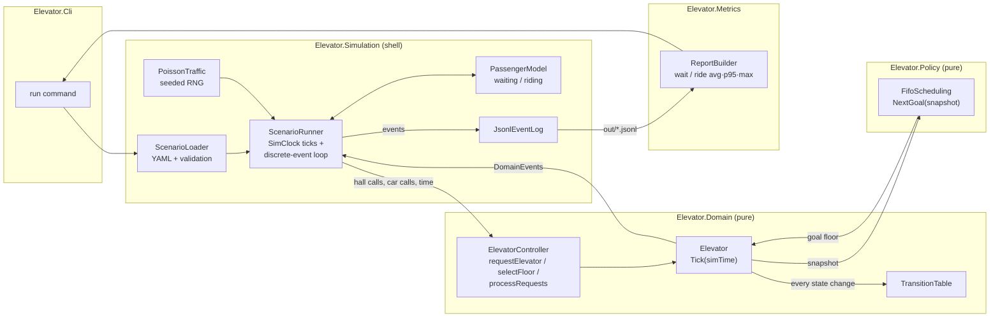
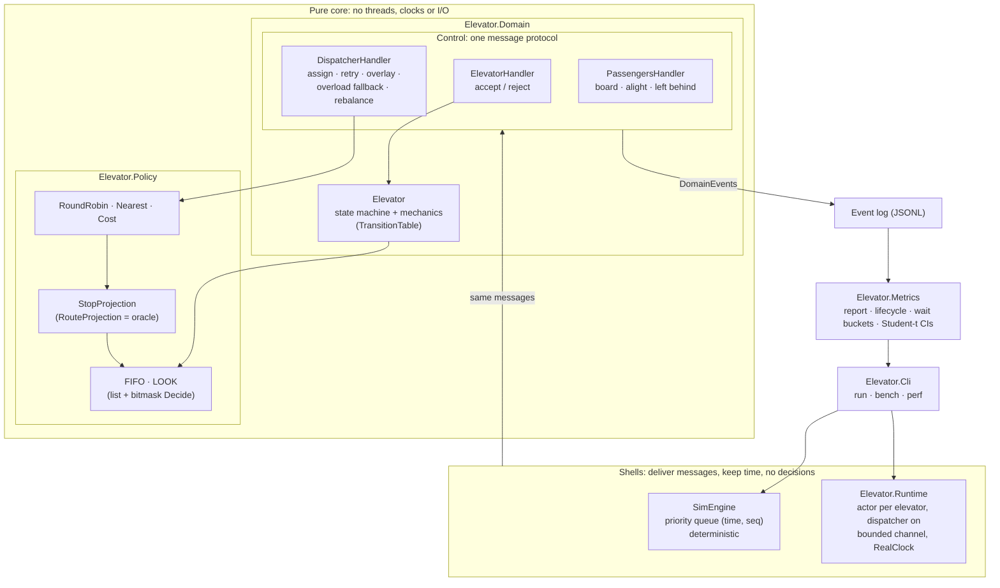
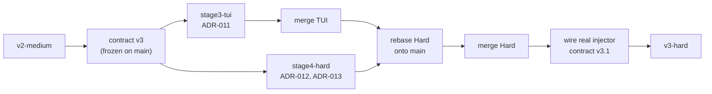
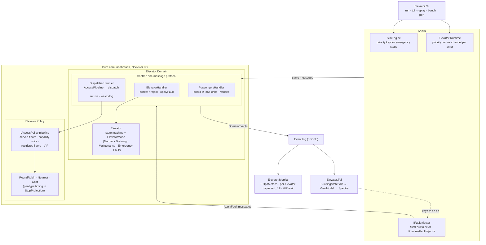
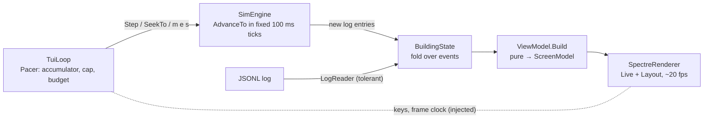

# Architecture evolution

How the design grows stage by stage. Each version links to the ADRs that justify it.

## v1: Easy (tag `v1-easy`)

One elevator, floors 1–10, FIFO hall-call scheduling with real mechanics, a headless deterministic simulation.
See ADR-001 (FIFO), ADR-002 (state machine) and ADR-003 (sim clock and pure core).

Key properties:
- Arrows into Domain and Policy carry data only. Those projects never call out, read a clock or do I/O.
- The event log is the only input to Metrics. The `run` command builds its report by reading back the file it wrote.
- The same scenario and seed give a byte-identical log at any tick size.

Baseline measured at v1 (`scenarios/v1-poisson.yaml`, seed 42, FIFO): wait avg 77.0 s, p95 193.0 s,
max 242.0 s; 69/69 served.

## v2: Medium (tag `v2-medium`)

Four elevators on 20 floors with destination dispatch, LOOK, cost-based dispatch, capacity, and a real threaded
runtime next to the deterministic simulator. The ADRs:

| ADR | Decision |
|---|---|
| 004 | LOOK per elevator (supersedes 001) |
| 005 | actors and one shared protocol, not locks |
| 006 | the cost function, its fast projection, staleness, overlay and overload |
| 007 | the event log as backbone |
| 008 | metric definitions and two kinds of time |
| 009 | destination dispatch and capacity |
| 010 | next-trip under full load |

Key properties:
- **All decisions are in pure handlers and policies.** The deterministic engine and the actor runtime deliver the same
  messages to them; a cross-check test runs the same scenario through both.
- **The dispatcher never shares memory with elevators.** It sees snapshots (possibly stale) plus its own pending
  proposals (overlay); elevators have the final say (accept / reject).
- **Every measured claim comes from the event log, with paired CIs on common random numbers.**

**Results at v2** (wait avg / p95 in sim seconds, held-out seeds 21–40, next-trip):

| Profile | FIFO + Nearest (baseline) | LOOK + Nearest | LOOK + Cost (default) |
|---|---|---|---|
| up-peak | 26.9 / 103.9 | 20.7 / 59.4 | **15.8 / 37.9** |
| down-peak | 251.1 / 584.6 (saturated) | 29.3 / 87.7 | **20.6 / 53.2** |
| lunch | 95.4 / 325.7 | 21.0 / 78.1 | **13.8 / 38.4** |

Sources: [m5-next-trip](results/m5-next-trip.md), [m5-capacity-modes](results/m5-capacity-modes.md);
the progression is in [docs/results.md](results.md).

## v3: Hard (tag `v3-hard`)

v3 was built as two parallel branches off `v2-medium`, against a contract frozen on `main` first
([contract-v3](contract-v3.md)): event types, snapshot fields and the `IFaultInjector` seam. Neither branch could edit
it, so they could not drift apart:

| ADR | Decision |
|---|---|
| 011 | TUI: a fold over the event log, a fixed-tick pacer, and seeking by re-simulation or re-fold |
| 012 | elevator types as configuration; access policies as an eligibility pipeline before cost |
| 013 | maintenance, emergency stop and faults as modes; commands as messages; the watchdog |

### What changed in the shape

- **The v2 shape held.** Types, eligibility and faults went into the pure core and the shared handlers, so the
  deterministic engine and the actor runtime got them at once. The TUI is one more consumer of the log, like Metrics.
- **The TUI never drives the simulation.** It only advances it in fixed 100 ms ticks, and its fault keys go through
  the same `IFaultInjector` as the scenario's fault schedule. The fold is shared by live and replay, and it is
  checked against the engine's own state on default, chaos and typed-fleet runs.
- **Eligibility comes before cost.** A denied elevator is invisible to every dispatch path; a request no elevator may
  take is refused (`AccessDenied` with no elevator), never lost.
- **Out of service is a mode, not a state.** The spec's `ElevatorState` is unchanged; two transition-table edges were
  added (`EmergencyHalt`, `EmergencyClose`).
- **The watchdog rides on the dispatcher's snapshot stream** plus a per-floor progress report, with T = 30 s. H3/H4
  measure the trade-off: lower T detects sooner but false-alarms on long freight dwells.

### Contract v3.1 (at merge)

Both branches hit gaps that only a schema change could close. Since the contract was frozen, they reported them
instead of patching around them. The amendment adds **optional fields, written only when set**:
- `PassengerArrived.load / vip / accessLevel`;
- `SimulationStarted.fleet`.

So default logs are byte-identical. It closes three gaps:
- the TUI shows load in load units and each elevator's type and capacity;
- `bypassed_full` uses each elevator's own capacity × threshold;
- the report splits VIP from non-VIP wait.

### Merge verification

| Check | Result |
|---|---|
| All tests (`-warnaserror`) | pass (Domain 175, Policy 84, Simulation 95, Metrics 26, Tui 91, Runtime 9) |
| Same seed across TUI speeds | lunch, demo, chaos, fleet: identical log hash at 0.5×, 10× and headless; chaos via the CLI at 0.5×, 10×, max |
| v2 results with faults off | 8 bench files and 4 run logs byte-identical with `v2-medium` (wall time and output path aside) |
| chaos.yaml in the TUI | M / E / F markers and the ops panel update live; 9 / 9 commands applied, 264 / 264 served |

**Results at v3** (wait avg / p95 in sim seconds, held-out seeds 21–40):

| Question | LOOK + Cost | LOOK + Nearest |
|---|---|---|
| chaos schedule vs none, same passengers ([h1](results/h1-chaos.md)) | 13.8 / 38.4 → 19.6 / 58.9 | 21.0 / 78.1 → 25.6 / 87.0 |
| typed fleet with access policies ([h2](results/h2-fleet.md)) | **14.0 / 39.7** | 22.8 / 81.9 |
| watchdog T = 5 / 10 / 30 / 60 s: detect ([h3](results/h3-watchdog-timeout.md)) | 6.0 / 11.3 / 31.9 / 61.2 s | – |
| watchdog false positives, fault-free ([h4](results/h4-watchdog-false-positives.md)) | ≈ 61–65 per run at T = 5 s on the fleet; none at 10 or 30 s | |

### TUI note (stage 3)

`Elevator.Tui` adds `elevator tui <scenario>` (live) and `elevator replay <log.jsonl>` (ADR-011). It is three
layers, and nothing flows back from the screen to the engine:

- **One fold for live and replay**, checked against `SimEngine.Elevators` / `Waiting`.
- **Speed cannot change results:** 0.5×, 10× and headless give the same log hash.
- **Seeking:** live re-simulates, re-applying the operator commands it recorded; replay re-folds the log.

### Hard-stage note (stage 4)

The v2 shape held. Types, eligibility and faults went
into the pure core and the shared handlers, so both shells got them at once:
- **Types are configuration** (`building.types`/`fleet`). The elevator and `StopProjection` replay each elevator's own
  timing and served floors, so cost dispatch predicts an express as an express.
- **Eligibility comes before cost.** A composable `IAccessPolicy` pipeline (served floors, capacity units, floor
  restrictions, VIP) runs in the dispatcher once per request. A denied elevator is invisible to every dispatch path; a
  request no elevator may take is refused, never lost.
- **Out of service is a mode, not a state** (`ElevatorMode`). Two new transition-table edges: `EmergencyHalt` and
  `EmergencyClose`.
- **Commands are messages** (`ApplyFault`) to the elevator's single owner. Emergency stops preempt: a priority control
  channel per actor, a priority key in the sim queue.
- **The watchdog rides on the dispatcher's snapshot stream,** plus a per-floor progress report.
- **Ops metrics come from the log only.**

With faults off and the default config, every v2 result regenerates byte-identically.
Results: [h1-chaos](results/h1-chaos.md), [h2-fleet](results/h2-fleet.md), [h3](results/h3-watchdog-timeout.md),
[h4](results/h4-watchdog-false-positives.md).
