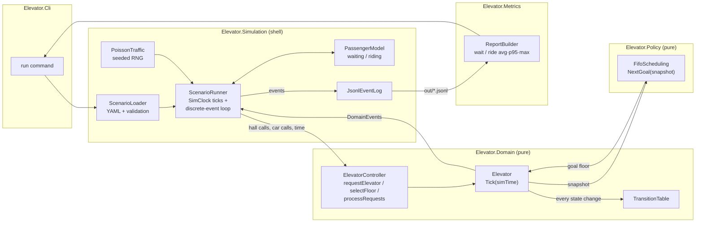

# Architecture evolution

How the design grows stage by stage. Each version links to the ADRs that justify it.

## v1: Easy (tag `v1-easy`)

One elevator, floors 1–10, FIFO hall-call scheduling with real mechanics, a headless deterministic simulation.
See ADR-001 (FIFO), ADR-002 (state machine) and ADR-003 (sim clock and pure core).

Key properties:
- Arrows into Domain and Policy carry data only. Those projects never call out, read a clock or do I/O.
- The event log is the only input to Metrics. The `run` command builds its report by reading back the file it wrote.
- The same scenario and seed give a byte-identical log at any tick size.

Baseline measured at v1 (`scenarios/v1-poisson.yaml`, seed 42, FIFO): wait avg 77.0 s, p95 193.0 s,
max 242.0 s; 69/69 served.

## v2: Medium

To be written: multiple elevators, actors in `Elevator.Runtime`, a dispatcher, and further strategies compared
against the v1 baseline.
